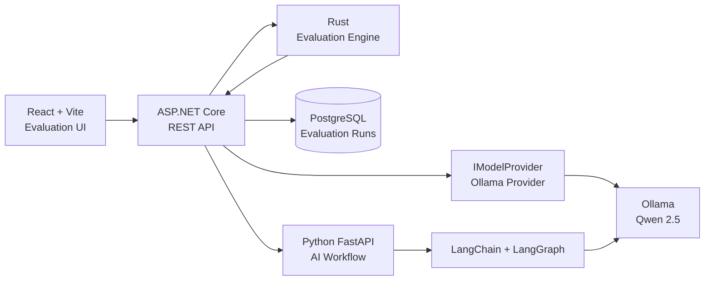

# 🧪 ModelBench

**An end-to-end AI model evaluation platform: LLM inference → automated evaluation → Rust scoring → A/B comparison → persistent performance history.**

A full-stack benchmarking platform for evaluating local AI models against defined expected outputs. ModelBench sends prompts to local LLMs through Ollama, evaluates their responses using a Rust evaluation engine, records metrics and results in PostgreSQL, and provides a React dashboard for individual evaluation and A/B model comparison.

---

## Demo

**ModelBench dashboard**

  
  <b>Figure 1.</b> ModelBench evaluation dashboard

- **Evaluation:** run an input against a selected AI model and evaluate the response.
- **A/B comparison:** run the same test against two models and compare their results.
- **Metrics:** view pass/fail, semantic similarity, latency, token usage and retries.
- **History:** review previously recorded evaluation runs.

**Demo video** (silent, about 2 minutes): [ModelBench demo]([ModelBench.zip](https://github.com/user-attachments/files/35229387/ModelBench.zip)

)

The recording shows an individual model evaluation, an A/B comparison between Qwen models, evaluation metrics, and persisted evaluation history.

---

## Architecture

---

## Tech stack

| Area | Technologies |
|---|---|
| Frontend | React, TypeScript, Vite |
| Backend | C#, ASP.NET Core, REST API |
| AI workflow | Python, FastAPI, LangChain, LangGraph |
| LLM inference | Ollama, Qwen 2.5 |
| Evaluation | Rust |
| Database | PostgreSQL, Entity Framework Core |
| Testing | xUnit, pytest, Rust tests |
| Tools | VS Code, PowerShell, Git |

---

## Concepts applied

**AI evaluation**
- Exact-match and rule-based evaluation
- Semantic similarity scoring
- Pass/fail evaluation rules
- Model response comparison

**Benchmarking**
- A/B model comparison
- Latency measurement
- Token usage tracking
- Retry tracking
- Evaluation history

**Backend**
- REST API architecture
- Provider abstraction through `IModelProvider`
- Separation of model inference and evaluation
- Persistent evaluation results

**LLM engineering**
- Local LLM inference through Ollama
- LangChain integration
- LangGraph workflow orchestration
- Model-independent evaluation pipeline

**Rust**
- Dedicated evaluation engine
- Cross-language integration with the C# backend
- Automated evaluation logic

**Software engineering**
- Unit and integration testing
- PostgreSQL persistence
- React frontend with API integration
- Modular backend architecture

---

## Data

ModelBench uses structured evaluation test cases containing an input, expected output and model response. Evaluation runs are stored in PostgreSQL together with evaluation results and performance metrics.
